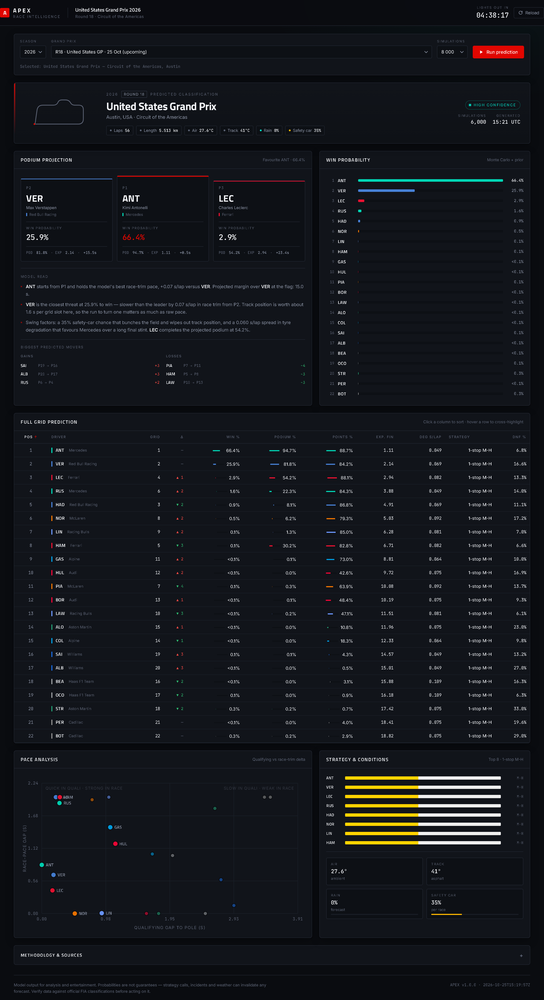

# APEX — F1 Race Predictor

Predicts the finishing order and win / podium / points probabilities for a Formula 1
race, using **OpenF1**, **Jolpica-F1** and **FastF1** as data sources. Ships a JSON
contract plus a single-page dashboard.

The engineering plan and UI design brief live in [`f1.md`](f1.md).



---

## Quick start

Two ways to run it. The **web app** gives you buttons; the **CLI** gives you a terminal table.

### Web app — with buttons

```bash
python app.py            # http://localhost:5000
```

On Windows just double-click **`run.bat`** — it starts the server and opens your
browser once it is listening. `run.bat --web` does the same thing explicitly.

Pick a Grand Prix, choose how many simulations, press **Run prediction**. The page
polls the job and re-renders when it lands.

### CLI — terminal table

```bat
run.bat --cli                    :: today's race
run.bat --date 2026-10-25        :: specific date
run.bat --round 18 --sims 20000  :: explicit round, more simulations
run.bat --backtest               :: replay the season
```

Or directly: `python run.py --date 2026-10-25`.

The first run creates `.venv` and installs dependencies automatically (a few
minutes); later runs start immediately. Arguments are passed straight through
to `run.py`.

### Manual / macOS / Linux

```bash
python -m venv .venv
.venv/Scripts/activate          # Windows
# source .venv/bin/activate     # macOS / Linux
pip install -r requirements.txt

python app.py                   # web UI
python run.py --date 2026-10-25 # CLI
```

> The system `python` on PATH usually has no numpy/scikit-learn. Always run through
> `run.bat`, or activate `.venv` first — otherwise you will get
> `ModuleNotFoundError: No module named 'numpy'`.

The dashboard also works as a plain file (`dashboard/index.html`) — no server, no
build step — but the buttons are disabled there, since live predictions need the API.

### If something breaks

| Symptom | Fix |
|---|---|
| `ModuleNotFoundError: No module named 'numpy'` | You ran the system `python`. Use `run.bat`, or activate `.venv` first. |
| `run.bat` says dependency installation failed | Check the network, then run `run.bat` again — it retries the install. |
| `.venv` stops working after a Python update | Delete the `.venv` folder and run `run.bat` again; it rebuilds from whatever Python is on your PATH. |
| `run.py` reports `FastF1 unavailable` | Expected — see the data-source note below. The forecast is unaffected. |
| Dashboard says `Static preview` | You opened the HTML directly. Run `python app.py` and use `http://localhost:5000`. |
| Buttons greyed out | Same cause — no API. Start the server. |

---

## Deploy to Render

The repo ships a `render.yaml` blueprint, so Render can provision everything in one step.

1. **New → Blueprint** in the Render dashboard, select this repository, apply.
   (Or **New → Web Service** with the settings below.)
2. Wait for the first build. `pip install -r requirements.txt` takes a couple of minutes.
3. Open the URL, pick a race, press **Run prediction**.

| Setting | Value |
|---|---|
| Build command | `pip install -r requirements.txt` |
| Start command | `gunicorn app:app --bind 0.0.0.0:$PORT --workers 1 --threads 8 --timeout 120` |
| Health check | `/api/health` |
| Environment | `PYTHON_VERSION=3.12.5`, `F1_CACHE_DIR=/tmp/f1cache`, `F1_DEFAULT_SIMS=8000` |

### Why one worker

Predictions are CPU-bound and the trained prior lives in process memory. A single
worker with 8 threads is both faster and correct — extra workers would each train
their own prior and keep their own job queue, so a job started on one would 404 on
another.

### What the free tier does to you

- **Spins down after 15 min idle.** The next visit takes ~15 s to wake; the prior is
  retrained in a background thread at boot, so the page itself loads immediately.
- **Ephemeral disk.** The API cache lives in `/tmp` and repopulates per instance.
  Expect a slow first prediction after each cold start.
- **512 MB RAM.** Comfortable at 8 000 simulations; 40 000 is available from the
  dropdown if you want it.

### API

| Method | Path | Purpose |
|---|---|---|
| `GET` | `/api/health` | Liveness + whether the prior is trained |
| `GET` | `/api/races?season=2026` | Schedule and the sensible default round |
| `GET` | `/api/prediction` | Latest result (falls back to the committed one) |
| `POST` | `/api/predict` | Queue a run — `{season, round, sims}` → `202 {job_id}` |
| `GET` | `/api/jobs/<id>` | `{status, stage, progress, result?}` |

---

## Outputs

| File | Purpose |
|---|---|
| `output/prediction.json` | Full model output (the UI contract) |
| `dashboard/prediction.js` | Same payload, wrapped as `window.PREDICTION` for the dashboard |
| `output/backtest.json` | Season replay metrics |

---

## How it works

```
OpenF1  ──►  qualifying, laps, stints, compounds, weather, pit stops
Jolpica ──►  standings, 5-season results, circuit history
FastF1  ──►  telemetry / long-run pace (optional enrichment, see note)

        ▼
 feature engineering   quali gap · race-trim pace · deg rate · form · grid
        ▼
 Monte Carlo race simulation (20 000 races, lap by lap)
        │  dirty air · overtaking · 1/2-stop strategy · safety car · DNF hazard
        ▼
 gradient-boosted prior (2 200 classified results, 2022–2026)
        ▼
 blend 60/40 → temperature calibration → constrained win-probability cap
        ▼
 prediction.json
```

### Race pace, and why it is measured the way it is

Practice sessions mix qualifying simulations (3–5 laps, low fuel) with race
simulations (8–18 laps, high fuel), and some sessions are partly wet. A raw
minimum lap therefore picks up low-fuel runs, and a raw median picks up traffic.

The model instead compares each driver's **long-run median minus their own
qualifying lap**. Fuel load, compound and track state are broadly common to the
field, so they cancel; what remains is genuine race-trim advantage. Stints are
first filtered to those within 6% of the session's fastest sustained run, and a
stint needs at least 5 timed laps before it counts.

Degradation is a car property, so it is pooled per team. Absolute measured slopes
are unreliable, but the ratio between teams is meaningful — so the field level is
anchored to a circuit prior and only the relative ordering is kept.

### What the probabilities mean

- `win_prob` / `podium_prob` / `points_prob` are marginal probabilities from the
  blended ensemble, calibrated so they sum to 1 / 3 / 10 respectively.
- `expected_finish` is conditional on finishing. Retirement risk is reported
  separately as `dnf_prob`.
- The published order is the predicted classification, sorted by `expected_finish`.
- `contributions` breaks each driver's projection into qualifying pace, race pace,
  team form, circuit affinity and reliability, so no number is a black box.

---

## Data-source notes

**FastF1 is currently unable to load 2026 sessions.** Formula 1 moved its live
timing feed behind an account — `livetiming.formula1.com/static/2026/Index.json`
returns HTTP 401 — so FastF1 reports `SessionNotAvailableError` and the pipeline
degrades to OpenF1, which supplies equivalent lap times, stint boundaries and
compound data. The `meta.model.fastf1` block in the output records this honestly
on every run. The FastF1 layer is kept in `src/sources/fastf1_source.py` and will
contribute automatically if access becomes available.

### "Why is it asking for an F1 email and password?"

It isn't asking, and **you do not need an F1 account.** FastF1 3.9 added an optional
feature that signs in to the official F1 timing feed; it looks for the environment
variables `F1_USERNAME` / `F1_PASSWORD`, and when they are absent it logs:

```
tokens    INFO     Signing in to Formula 1 account...
transport WARNING  Failed to authenticate with Formula 1 account, continuing without
                   authentication: No F1 account credentials available.
```

That is the library announcing it will proceed without a login — not an error, and not
a request aimed at you. Since the 2026 feed is account-gated anyway, the login would
buy nothing here.

Two things are now in place so you never see it:

1. **All FastF1 loggers are disabled** (`src/sources/fastf1_source.py::_silence`), including
   ones created after import.
2. **The "unavailable" verdict is cached for 6 hours**, so the probe runs at most twice a
   day instead of on every run — that alone removed ~6 s from each invocation.

You will instead see one clear line:

```
FastF1 : skipped — F1's timing feed needs an account, so OpenF1 is used instead (no credentials required)
```

**Jolpica paginates at 100 rows per page.** `src/sources/jolpica.py` walks the
`offset` parameter and merges pages by `(season, round)`. Note that
`/{season}/results/1.json` means *round 1*, not *all results* — the pipeline uses
`/{season}/results.json`.

---

## Layout

```
app.py                 Flask web service: job queue + REST API for the buttons
run.py                 CLI entrypoint
run.bat                Windows launcher (creates .venv, installs deps, runs)
render.yaml            Render blueprint (build, start, health check, env)
Procfile               start command, if you deploy without the blueprint
requirements.txt       runtime deps (no FastF1 — it adds ~150 MB and is unused)
requirements-fastf1.txt  adds the optional telemetry layer
src/
  config.py            circuit database, physics constants, model weights
  cache.py             JSON snapshot cache (~/.cache/f1predictor)
  sources/openf1.py    live timing, results, laps, stints, weather
  sources/jolpica.py   standings, history, ML corpus (paginated)
  sources/fastf1_source.py   optional telemetry layer
  features.py          feature engineering + pace normalisation
  simulate.py          vectorised lap-by-lap Monte Carlo
  ml_model.py          gradient-boosted finish-bucket prior
  blend.py             ensemble, calibration, explainability
  report.py            JSON assembly
dashboard/             index.html · styles.css · app.js · prediction.js
docs/dashboard.png     README screenshot
output/                prediction.json · backtest.json
```

---

## Validation

`python run.py --backtest --season 2026` replays every completed round, rebuilding
features from data available *before* each race and training the prior on 2022–2025
only, so each round is genuinely out-of-sample. Results land in `output/backtest.json`.

Measured on 2026 rounds 1–17:

| Metric | Result |
|---|---|
| MAE of expected finish | **3.60 positions** |
| Brier score (summed over the field, range 0–2) | **0.694** |
| Actual winner in predicted top 3 | **71%** (12/17) |

Round MAE ranged 2.21 (Belgium) to 5.55 (Monaco). Street circuits and safety-car-heavy
races are the hardest, as expected.

### Calibration check

With all cars set to identical pace, the simulation gives pole position a **33%** win
rate, against COTA's historical 4 wins from 13 poles (31%). That is the anchor used to
set the value of track position (`GRID_GAP`).

The season backtest originally scored a Brier of 0.814 — over-confident on the
favourite. Temperature scaling and shrinkage toward uniform were both tested and
rejected (each distorted or flattened the tail). Geometric blending plus a milder
calibration temperature brought it to 0.694 without distorting the field.

---

## Limitations

- Tyre degradation and long-run pace from practice are noisy; the model shrinks
  both toward priors rather than trusting them fully.
- The 2026 regulation change weakens historical priors; 2026 rows are up-weighted
  but the prior corpus is still mostly pre-2026 machinery.
- Safety-car timing is stochastic, not forecast — it is a probability, not a
  prediction.
- This is an analysis tool. It is not betting advice.
